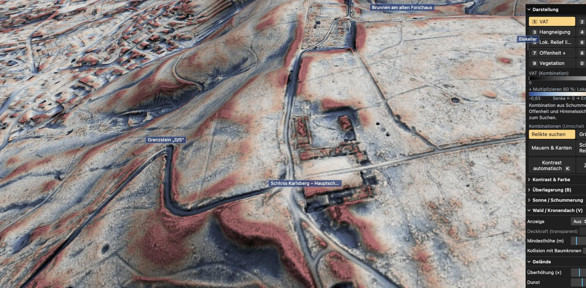
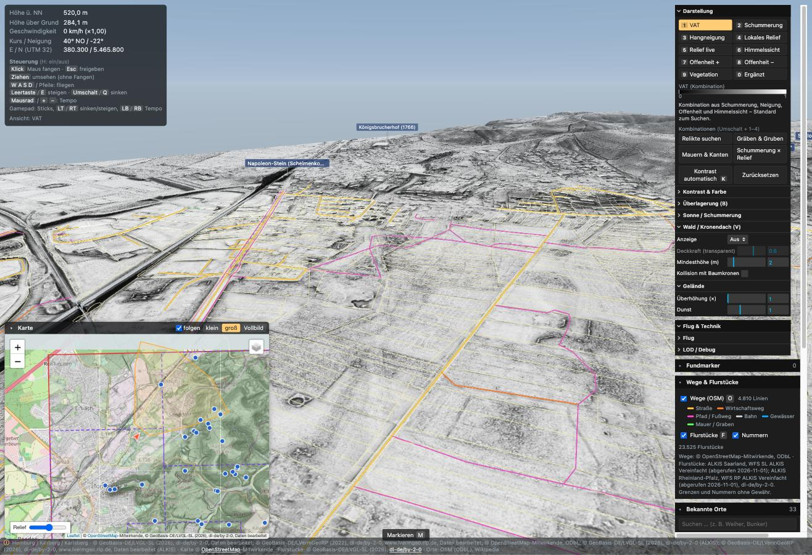
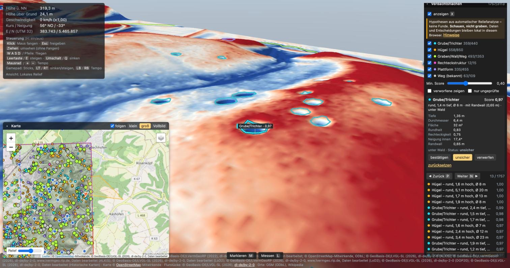
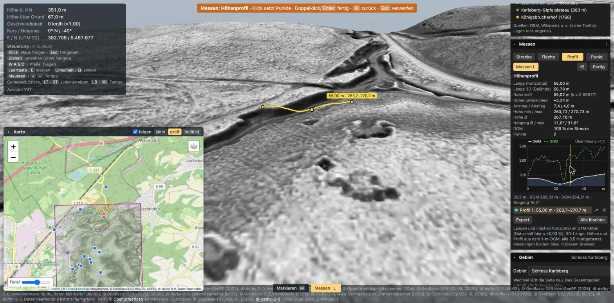
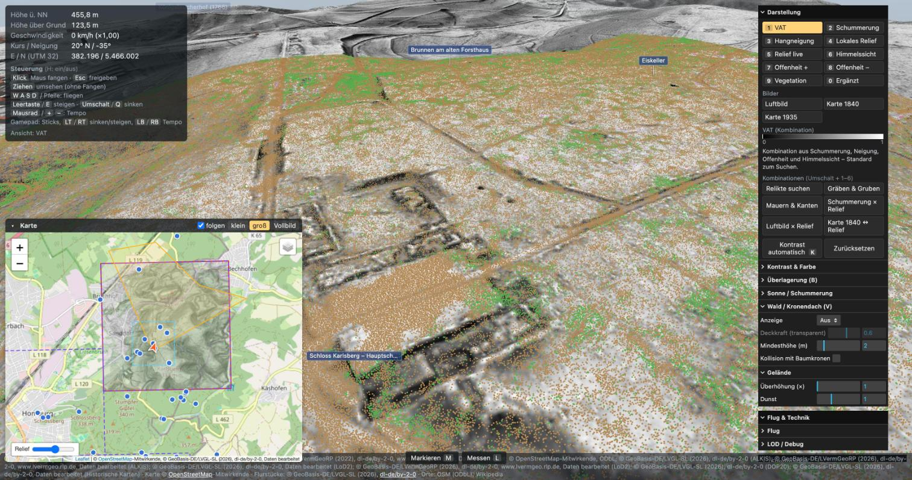
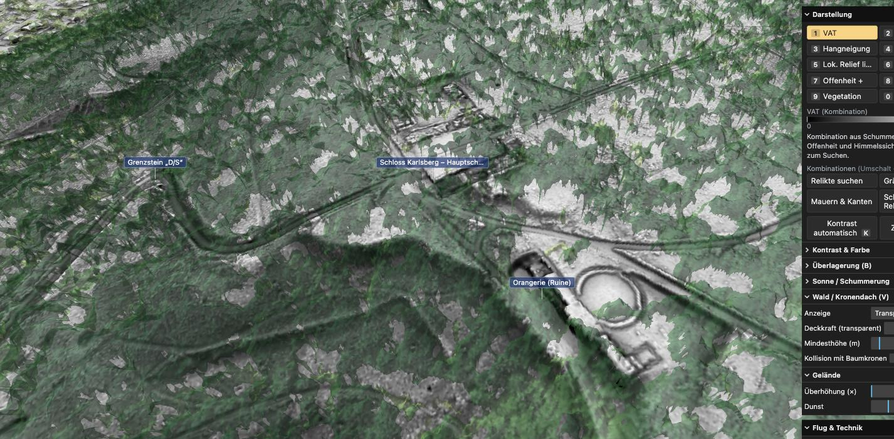

# Saar LiDAR Explorer

> **Live:** [https://open-kirrberg.github.io/saar-lidar-explorer/](https://open-kirrberg.github.io/saar-lidar-explorer/) · Schloss-Viewer: [https://open-kirrberg.github.io/saar-lidar-explorer/castle/](https://open-kirrberg.github.io/saar-lidar-explorer/castle/) · Daten: [https://open-kirrberg.github.io/saar-lidar-data/](https://open-kirrberg.github.io/saar-lidar-data/), [https://open-kirrberg.github.io/saar-lidar-data-2/](https://open-kirrberg.github.io/saar-lidar-data-2/) · [github.com/Open-Kirrberg](https://github.com/Open-Kirrberg)  
> Code: MIT ([LICENSE](LICENSE)). Daten und Bilder behalten ihre Lizenzen (dl-de/by-2-0, ODbL, CC BY-SA 2.0 DE) – siehe [NOTICE.md](NOTICE.md). **Schauen, nicht graben:** Verdachtsflächen sind ungeprüfte Hypothesen.


A personal, local-only browser app for flying like a drone over the **2025 Saarland airborne LiDAR terrain** (LVGL ALS 2025 open data, with Rheinland-Pfalz fill at the border). The goal is to discover relicts under the forest — walls, moats, pits, bunkers, hollow ways, terraces — around **Schloss Karlsberg, Homburg and Kirrberg**.

A Python pipeline turns the raw 1 m GeoTIFFs (and LAZ, CityGML, WMS/WFS sources) into static chunks. A Vite/TypeScript/three.js app renders them with archaeological relief shading, synced to a Leaflet/OpenStreetMap minimap. **The UI is German**; code and docs are English.

> **Schauen, nicht graben.** Everything the app highlights is a *hypothesis* from terrain data, not a find. See [Heritage and ethics](#heritage-and-ethics).

| | |
|---|---|
|  |  |
| *Relikte suchen* at 2× exaggeration: the foundations of Schloss Karlsberg (burnt 1793) under the forest | Overall AOI (6 × 8 km): OSM paths and parcels draped in 3D, minimap with focus areas |
|  |  |
| *Verdachtsflächen*: pit candidates with scores, reasons and a private review | *Messen*: height profile across a hollow way (DGM + DOM, sampled every 0.5 m) |
|  |  |
| *Punktwolke*: classified ALS points with the *Röntgen* clip (vegetation removed above the ground) | *Wald transparent*: the canopy height model over the bare-earth relief |

## Quickstart

Requirements: [uv](https://docs.astral.sh/uv/) (it installs Python 3.12), Node.js + pnpm (developed with Node 24 / pnpm 12), and about 5 GB of free disk space for both AOIs (this checkout: 1.7 GB raw downloads + 1.6 GB work rasters in `data/`, 1.8 GB app data).

```bash
# 1. Data: downloads open data and writes app/public/data/<aoi>/ (see pipeline/README.md)
cd pipeline
uv sync
./run.sh karlsberg            # 3 × 3 km around Schloss Karlsberg (first run ≈ 4 min)
./run.sh overall              # 6 × 8 km Homburg / Kirrberg / Karlsberg, the app's default AOI (≈ 1.4 GB app data)
./run.sh overall build xyz    # re-run selected steps only

# 2. App (development)
cd ../app
pnpm install
pnpm dev                      # prints the URL (Vite default port 5173); without pipeline data it opens the synthetic ?aoi=fixture

# 3. App (production build, local only)
pnpm run serve:local          # typecheck + build, then serve dist/ + the data dir on http://127.0.0.1:5250/
```

`?aoi=<name>` picks a dataset (`overall`, `karlsberg`, `fixture`); without it the app opens `overall`, then `karlsberg`, then the synthetic `fixture`. The URL hash (`#E,N,h,heading,pitch,layer,…`, see [app/README.md](app/README.md#url-hash)) is a bookmark of the current view; it never contains markers, candidates or measurements.

Checks: `cd app && pnpm run test` (vitest), `cd pipeline && uv run pytest -q`, or all gates at once with `.claude/skills/sle-roadmap/scripts/verify.sh`.

### Local packaging: one data directory, no copies

The AOI datasets (≈ 300 MB for Karlsberg, ≈ 1.4 GB for overall) are **never copied into `dist/`**. `pnpm run build` copies only the small files in `public/` (e.g. `data/pois.geojson`); `dist/` stays at about 2 MB.

There is one data directory, `app/public/data/`, where the pipeline writes and from which every server reads:

| Command | Serves the app from | Serves `data/` from |
|---|---|---|
| `pnpm dev` | sources (Vite dev server) | `app/public/data/` |
| `pnpm run build && pnpm preview` | `dist/` | `app/public/data/` (preview middleware in `app/vite.config.ts`) |
| `pnpm run serve:local` | build + preview on `127.0.0.1:5250` (strict port, loopback only) | `app/public/data/` |

- **Data elsewhere** (e.g. an external disk): set `SLE_DATA_DIR=/Volumes/disk/sle-data` (absolute, or relative to `app/`) for `pnpm dev`, `pnpm preview` or `pnpm run serve:local`. Files found there win; files missing there still come from `app/public/data/`. The pipeline always writes to `app/public/data/`, so to keep a single copy on another disk, make `app/public/data` a symlink to it instead.
- **Another static server:** the build uses a relative base (`./`) and loads `./data/<aoi>/manifest.json`, so any static file server works once `dist/data/<aoi>` links to the dataset (e.g. `ln -s ../../public/data/overall app/dist/data/overall`). Run `pnpm run build` again before that, and remove the link before measuring `dist/` (verify.sh checks that `dist/` stays under 20 MB).
- `VITE_DATA_URL=https://…/data/ pnpm run build` points the build at a separate data host (CORS needed if cross-origin).
- **Public release (GitHub Pages, org Open-Kirrberg):** `SLE_PUBLIC=1 pnpm run build` builds the public site (base `/saar-lidar-explorer/`, data from the `saar-lidar-data` / `saar-lidar-data-2` Pages sites, AOI `overall`, castle viewer under `castle/`). Export scripts, limits and the publishing steps: [scripts/release/RELEASING.md](scripts/release/RELEASING.md). Find markers, reviews and measurements stay in each browser.

The minimap's OpenStreetMap/OpenTopoMap tiles, the live DOP/Flurstück WMS overlays and the optional online Flurstück lookup need a network connection; the 3D view, relief layers, buildings, historic maps, point clouds, candidates and the *Meldung* report work from local data.

## Keyboard shortcuts (Steuerung)

Global keys are ignored while typing in a text field and with Ctrl/Cmd/Alt held. `H` shows or hides the help in the HUD.

| Key | Action |
|---|---|
| Click canvas / `Esc` | Capture the mouse for mouse look / release it |
| Drag (without capture) | Look around |
| `W` `A` `S` `D` / arrow keys | Fly forward, left, back, right (horizontal, drone style) |
| `Space` / `E` | Climb |
| `Shift` / `Q` | Descend |
| Mouse wheel, `+` / `−` | Speed multiplier (speed also grows with height above ground) |
| `1`–`9`, `0` | Relief mode: VAT, Schummerung, Hangneigung, Lokales Relief, Relief live, Himmelssicht, Offenheit +, Offenheit −, Vegetation, Ergänzt |
| `Shift` + `1`–`N` | Relief preset (Relikte suchen, Gräben & Gruben, Mauern & Kanten, Schummerung × Relief, Luftbild × Relief, Karte 1840 ↔ Relief) |
| `B` | Overlay on/off |
| `V` | Forest canopy: aus → transparent → voll |
| `K` | Automatic contrast |
| `O` | OSM paths in 3D |
| `F` | Flurstücke + Flurnummern in 3D |
| `G` | LoD2 buildings |
| `M` | Markieren (place a find marker by clicking) |
| `L` | Messen; while on: click adds a point, double-click / `Enter` finishes, `Backspace` removes the last point, `Esc` discards |
| `X` | Verdachtsflächen (relict candidates) on/off |
| `N` / `P` | Next / previous candidate (while candidates are shown) |
| `C` | Punktwolke (point cloud) on/off |
| `H` | Control help in the HUD |
| `?` | Einführung (introduction) with all shortcuts |
| `Esc` | Ends the tour / closes the introduction |
| Gamepad | Left stick moves, right stick looks, `LT`/`RT` descend/climb, `LB`/`RB` speed |

Keys for layers that the current dataset does not have (e.g. `C` without point clouds) do nothing. Details: [app/README.md](app/README.md#controls-steuerung).

### On a phone in your local network (HTTPS)

Phones only reveal their location (*Mein Standort*) and compass to pages served over HTTPS, so `http://<LAN-IP>:…` won't do. For a short session at home:

```bash
cd app
pnpm run dev:lan              # HTTPS on 0.0.0.0:5243, prints https://<LAN-IP>:5243/ — open that on the phone
```

- The certificate is self-signed: confirm the browser warning once on the phone (Safari: *Details anzeigen → Website besuchen*; Chrome: *Erweitert → Weiter*).
- **Privacy:** while it runs, **anyone on the same network** can open the app, including your relict candidates and the datasets. Use it on a trusted home network only, keep it short-lived and stop it with `Ctrl+C`. Find markers, reviews and measurements stay in each browser's own storage (the phone has its own). Your position is never stored or sent.
- This is LAN-only development serving; the public site is the separate GitHub Pages build (`scripts/release/RELEASING.md`).

## Features

| ID | Feature |
|---|---|
| F1 | Data pipeline: LVGL DGM1/DOM1 2025 + RLP fill → Terrarium height chunks, relief layers, manifest |
| F2 | 3D terrain with per-pixel relief shading: VAT, hillshade, slope, local relief, sky view, openness; overlays, blend modes, colour maps, auto contrast, exaggeration 1–5× |
| F3 | Drone flight with terrain following and speed scaled by height above ground; gamepad |
| F4 | Synced Leaflet/OSM minimap: camera marker, view footprint, click-to-fly |
| F5 | Forest canopy (DSM − DTM) off / transparent / full |
| F6 | Find markers: pin in 3D with notes and Flurstück, list, map, local storage, GeoJSON import/export |
| F7 | *Bekannte Orte*: 44 researched sites with search, 3D labels and fly-to |
| F8 | "Schauen, nicht graben" disclaimer and data attribution |
| F9 | Overall AOI (6 × 8 km) with overview levels, quadtree streaming and a GPU memory budget |
| F10 | OSM roads, paths, water and walls draped in 3D |
| F11 | LoD2 buildings (Saarland + RLP) in 3D, plus a building mask for the canopy |
| F12 | Flurstücke + Flurnummern: live WMS on the map, draped lines and labels in 3D |
| F13 | Orthophoto (DOP20, 0.5 m) as 3D texture and live map overlay |
| F14 | Historic maps (Bayer. Positionsblätter 1836–41, TK25 1935–40) in 3D and on the map |
| F15 | *Verdachtsflächen*: rule-based relict candidates (pit, mound, linear, rectangle, platform; plus a coarse pass for large platforms, moats and terrace edges) with scores, reasons and a private review |
| F16 | *Punktwolke*: classified ALS points for three focus areas, with class colours and the *Röntgen* height clip |
| F17 | *Messen*: distance, area, height profile and point, GeoJSON export |
| F18 | *Meldung*: one self-contained offline HTML report per marker for the Landesdenkmalamt (download only, nothing is sent) |
| v1.0 | *Einstellungen & Hilfe*: persistent settings (display, exaggeration, sun, flight, quality, HUD help) in the browser, two-click reset that keeps markers, reviews and measurements |
| v1.0 | *Ansicht teilen* (toolbar *Teilen*): copies a link with position, view, relief preset, exaggeration and sun — never markers or candidates; shows the link for manual copying when the clipboard is unavailable |
| v1.0 | *Einführung* (`?`) with all shortcuts and a *Tour* through up to 7 known sites, each with a matching relief preset |
| v1.0 | *Qualität* Hoch / Mittel / Niedrig: pixel ratio, terrain streaming and LOD, label and building distances, point budget (a budget set with the point-cloud slider is kept) |
| v1.0 | Accessibility: keyboard focus rings, labelled icon buttons, modal dialogs that keep shortcuts and focus inside, text contrast ≥ 4.5:1 |
| F20 | Mobile: *Einfach* layout on phones (full-screen 3D, bottom bar *Standort · Relief · Ebenen · Karte · Mehr*, bottom sheets), map-style touch gestures (pan, pinch, twist, tilt, double tap, long press → Fundmarker), automatic *Mobil* quality, *Mein Standort* (position stays in memory only), `pnpm run dev:lan` for HTTPS in the home network |
| F21 | 3D-Druck: `pipeline/print3d.py` writes joinable 3MF terrain tiles for a stock Bambu Lab P1S (main series 1:8500, 2 km → 235 mm; detail series 1:2125 with a datum per set; bowtie keys); card *3D-Druck* shows the print grid on the minimap and in 3D, generated tiles, filament totals and the command for missing tiles |

Status, decisions and open questions: [PRD.md](PRD.md).

## Data sources and licences

| Data | Source | Licence |
|---|---|---|
| DGM1 / DOM1 2025, LAZ 2025, LoD2, TrueDOP20, historic maps, ALKIS Flurstücke (WFS + INSPIRE WMS) | Landesamt für Vermessung, Geoinformation und Landentwicklung Saarland (LVGL), open data | [dl-de/by-2-0](https://www.govdata.de/dl-de/by-2-0) — `© GeoBasis-DE/LVGL-SL (2026)` |
| DGM1 2022 (border fill), LoD2, DOP20, ALKIS (WFS) | Landesamt für Vermessung und Geobasisinformation Rheinland-Pfalz (geobasis-rlp.de) | dl-de/by-2-0 — `© GeoBasis-DE/LVermGeoRP` |
| Streets, paths, water, walls; most POI coordinates; minimap tiles | OpenStreetMap contributors (Overpass, tile.openstreetmap.org), OpenTopoMap | [ODbL](https://opendatacommons.org/licenses/odbl/) / CC-BY-SA (OpenTopoMap) |

The exact attribution strings are written into each dataset's `manifest.json` by the pipeline and shown in the app's footer; every new source must add its entry there. The "freie Liegenschaftskarte SL" is not openly licensed and is not used. Raw downloads stay in the git-ignored `data/`, generated data in the git-ignored `app/public/data/`.

## Heritage and ethics

- The app shows **hypotheses** from terrain data. Ground monuments in the Saarland and in Rheinland-Pfalz are protected (SDschG Saarland, DSchG RLP); searching for or digging up finds requires a permit, and chance finds must be reported to the Landesdenkmalamt.
- **Schauen, nicht graben:** no digging or metal-detector guidance. The disclaimer opens on the first start and stays reachable via ⓘ in the footer.
- **Private by default:** find markers, measurements, candidate reviews and settings live only in the browser's localStorage. Relict candidates (`candidates/`) are generated locally and git-ignored; they are published only in the public data repository (user decision 2026-11-02), with a note that they are unverified hypotheses. Reports are downloaded, never sent.
- Public hosting: the user decided on 2026-11-02 to publish the app and the `overall` data (incl. candidates) on GitHub Pages under Open-Kirrberg; the disclaimer opens on the first visit there too.

## Repository layout and further docs

| Path | What |
|---|---|
| [PRD.md](PRD.md) | Living product document: vision, features, decisions log, changelog |
| [docs/data-contract.md](docs/data-contract.md) | Binding format between pipeline and app (frames, chunks, encodings, manifest) |
| [pipeline/README.md](pipeline/README.md) | Pipeline steps, sources, sizes, detection rules and evaluation |
| [app/README.md](app/README.md) | App architecture, rendering, controls, panels, known gaps |
| `research/` | Source research: data, tech stack, archaeology/POIs/legal, cadastre/historic maps |
| `docs/screenshots/`, `docs/previews/` | Verification screenshots, pipeline preview images |
| `schloss-karlsberg/` | Sub-project: researched 3D reconstruction of the palace |
| `.claude/skills/` | Project skills that drive the roadmap and the pipeline/renderer/detection work |

Coordinates are EPSG:25832 (ETRS89 / UTM 32N) everywhere in data and 3D (with a local origin); only the Leaflet map uses EPSG:3857.
