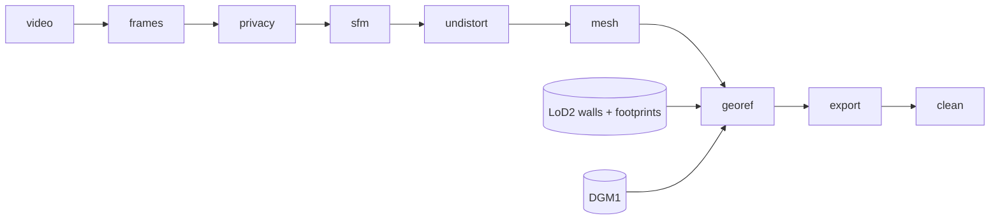

# 🎥 tools/capture — video → georeferenced zone mesh

One command turns a handheld walk-through video into a textured, georeferenced GLB for a **captured zone**
([ADR 0016](../../docs/adr/0016-zone-kinds-zone-contract.md), method: [ADR 0027](../../docs/adr/0027-captured-zone-method.md)).
Zone packaging (portal, spawn, manifest) is the zone contract's job, not this tool's.

```bash
tools/capture/run.sh bakery                    # all stages
tools/capture/run.sh bakery georef export      # selected stages (each reads the previous stage's output)
cd tools/capture && uv run python -I -m pytest # tests
```

Inputs are **untrusted data** (`data/raw/zones/<zone>/`): never executed, Python always runs with `-I`.
Everything generated stays in the git-ignored `data/work/zones/<zone>/`; QA renders go to the git-ignored
`docs/shots/v2.8/`.

## 🧭 Stages



| Stage | What | Tool |
|---|---|---|
| `frames` | Laplacian sharpness + LK optical flow on a 960 px proxy → keyframes every ~6 % of the image width of motion, sharpest in a band, max gap 30 frames | ffmpeg, OpenCV |
| `privacy` | Plates + people blurred **before** any reconstruction (PRD H13), see below | YOLOX-s (ONNX), Apple Vision |
| `sfm` | One shared `OPENCV_FISHEYE` camera, SIFT, sequential + quadratic matching, global mapper (fallback incremental). **Lens calibration only** (its poses are not used, see limits) | pycolmap |
| `undistort` | Fisheye → pinhole (same focal), EXIF 35 mm focal written for Object Capture | `cv2.fisheye` |
| `mesh` | Dense reconstruction, meshing, decimation and texture baking at several detail levels in one alignment | Apple Object Capture (`swift/pgtool.swift`) |
| `georef` | Level → scale from camera height → indoor/outdoor cameras → plan fit vs LoD2 (fixed scale) → height from DGM1 → residuals | numpy/scipy, `capture/similarity.py` |
| `export` | Crop, transform to the zone-local frame, downsize texture (JPEG), GLB per LOD + sidecar JSON + preview renders | trimesh |
| `clean` | Delete unblurred raw frames, COLMAP database + duplicate model (≈ 1.3 GB on the bakery) | — |

Every stage appends its wall-clock time to `data/work/zones/<zone>/timings.json` (the "hours per zone" metric).
Re-running `privacy` after `clean` needs the raw frames again: `run.sh <zone> frames privacy` (~40 s extra).

**Order matters:** privacy runs on the raw fisheye frames because the calibration needs SfM, and SfM must already see
blurred frames. Nothing downstream ever sees an unblurred frame.

### 🔒 Privacy (H13)

| Target | Detector | Action |
|---|---|---|
| Licence plates | YOLOX vehicles (car, motorcycle, bus, truck), tiled 3×2 + full frame → plate zone (lower 60 %, small vehicles whole); plus Vision OCR lines that match a German plate pattern | Gaussian + pixelate blur |
| People | YOLOX persons + Vision human rectangles | blur whole box |
| Large people | person area > 3 % of the frame, inside reviewed `people_frames` ranges | frame dropped |

- Boxes are tracked across keyframes, gaps filled and padded (`capture/boxes.py`), because a single missed plate is
  the costly error. Recall beats precision: portraits, dolls and plants that look like people get blurred too.
- **Human gate:** `privacy/qa_blurred_*.jpg` shows every blurred frame; `people_frames` in the zone TOML is the
  reviewed result (where live people are actually in view).

### 📐 Georeferencing

Object Capture output is not metric, and a walk-through sees few walls, so every step uses the **camera poses** too.

| # | Step | How |
|---|---|---|
| 1 | ⚖️ Level | Mean camera up-vector, refined by mean shift on near-horizontal face normals |
| 2 | 📏 Scale | Fixed, from the handheld **camera height** (`camera_height_m`): area-weighted peak of up-facing faces below the cameras = floor. Check: room height |
| 3 | 🏠 Indoor / outdoor | Camera indoor ⇔ ≥ 10 ceiling faces 0.2–5 units above it. **Exterior wall points** = vertical faces with ≥ 50 % outdoor cameras on their normal side (room walls 0.3 m inside the facade never match) |
| 4 | 🧭 Plan fit | FFT search over rotation (1°) × translation: LoD2 wall proximity + normal direction, × camera consistency⁴ (indoor cameras inside the **zone building**, outdoor cameras outside all LoD2 footprints). Then robust point-to-line ICP (`similarity.fit_similarity_2d`, scale fixed) from the top 6; pick by inliers × consistency⁴ |
| 5 | ⛰️ Height | Street ground near the outdoor cameras, outside footprints → median offset onto DGM1 |
| 6 | 🧪 Residuals | Plan, LoD2 corners, ground vs DGM1, eaves, runner-up hypothesis, along-wall shift profile → `georef.json`; QA top view over the DOP20 ortho → `docs/shots/v2.8/<zone>_georef_top.jpg` (the ortho is a visual check, not a fit input: roofs hide the walls) |

- The **zone anchor** in `zones/<zone>.toml` picks the zone building (the LoD2 building at the anchor).
- **Why scale is not fitted:** one straight facade + one corner fix no scale. ICP slid the scale to its bound.
- **Why LoD2 footprints, not the pipeline's `bldg.tif`:** that mask is dilated by one cell, so outdoor cameras
  hugging the facade counted as "inside".
- **Output frame:** `x = E − E0`, `y = h` (DHHN2016), `z = −(N − N0)`; E0/N0 = rounded zone anchor, stored in the
  sidecar `<zone>.glb.json` together with the 4×4 transforms.

## 🥖 Zone `bakery`

Bäckerei Heusser, Eckstr. 3, 66424 Homburg-Kirrberg (consented, PRD H6). One handheld wide-angle clip
(`DJI_0079.MP4`, 4000×3000, 3568 frames): along the street → into the shop → back out → covered passage.

### ⏱️ Timings (Apple M4 Max, 64 GB, 2026-11-04)

| frames | privacy | sfm | undistort | mesh | georef | export | clean | **total** |
|---:|---:|---:|---:|---:|---:|---:|---:|---:|
| 36 s | 203 s ¹ | 600 s | 11 s | 3250 s | 10 s | 1 s | 1 s | **4110 s ≈ 1.1 h** |

¹ Detector caches warm; 479 s cold → **≈ 1.2 h** from scratch, plus the human privacy review. Work dir 2.7 GB before `clean`, 1.4 GB after.

### 🧱 Result

| | medium | reduced |
|---|---:|---:|
| Triangles / vertices | 100,000 / 63,311 | 50,000 / 33,889 |
| Texture (JPEG) | 4096² | 2048² |
| GLB | 4.84 MB | 2.19 MB |

- Extent 19 × 23 m, 5 m high (local x −0.8…18.3, z −11.7…11.7, y 242.4…247.3 m). Shop interior, street facade,
  covered passage.
- Keyframes: 494 → 57 dropped (people close up) → **437**. All 437 registered in SfM (139 k points, 1.18 px
  reprojection) and Object Capture.
- Privacy: 363 frames blurred, 1540 boxes (137 plate tracks, 119 person tracks). Reviewed: `people_frames = [0, 1240]`
  (staff + customers in the shop); after it, only small or distant people, all blurred.

### 📐 Georeference residuals (target ≤ 0.5 m)

| Check | Result | |
|---|---|:-:|
| Exterior mesh points → LoD2 walls | median **0.04 m**, p90 0.33 m (23,250 pts, 99 % on the bakery building) | ✅ |
| LoD2 corner (NE corner of the bakery, the only one in view) | **0.22 m** (dE −0.16, dN +0.16) | ✅ |
| Ground → DGM1 | median **0.05 m**, p90 0.17 m, 100 % within 0.5 m (n = 20,074) | ✅ |
| Cameras consistent with LoD2 (indoor inside / outdoor outside) | 87 % (367 indoor, 70 outdoor) | ✅ |
| Scale 1.46 m / unit | from camera height 1.35 ± 0.15 m → **± 11 %**; room height 2.26 m plausible | ⚠️ prior |
| Eaves height (independent scale check) | not reached: mesh top 246.3 m vs LoD2 eaves 250.4 m | ➖ |
| Uniqueness | runner-up 6.8 m SSW along the facade scores 0.89 of the best | ⚠️ |

**Why the best fit and not the runner-up?** The street facade is one straight 24 m wall, so walls alone barely
separate the two positions. Three things decide:
- the along-wall profile is sharp (19,002 inliers at 0 vs ≤ 15,414 at ± 0.5 m);
- the passage's left wall, with the door and mailbox of No. 3, lands on the LoD2 north wall of the bakery building;
- the neighbouring building spans over the passage, as LoD2 has it.

A ± 11 % scale error moves points 10 m from the corner by up to ± 1.1 m. Only a measured length (tape, or the
eaves in a higher shot) would remove it.

### ⚠️ Known limits
- Glass, the display counter and plants come out weak or missing.
- **COLMAP poses are calibration-only.** After a similarity fit, its global-mapper trajectory disagrees with Object
  Capture's by median 1.5 m (p90 4.3 m). A splat run should start from `mesh/poses.json` + `mesh/points.ply` on
  `frames/undistorted` (pinhole K in `undistort.json`).

### 🖼️ QA renders (git-ignored, regenerated by `georef` / `export`)
`docs/shots/v2.8/bakery_georef_top.jpg` (mesh over LoD2 + ortho, cameras), `bakery_mesh_{oblique_se,oblique_nw,top}.jpg`

## 🧰 Toolchain (as run)

| Tool | Version |
|---|---|
| macOS / Apple silicon | 27.2 (26B123) |
| Swift (Object Capture, Vision CLIs) | 6.3.3 |
| ffmpeg | 9.0.2 |
| uv / Python | 0.11.20 / 3.12 |
| pycolmap | 4.2.1 |
| OpenCV (headless) | 5.0.0.93 |
| numpy / scipy / trimesh / rasterio | 2.5.4 / 1.18.1 / 5.2.0 / 1.5.2 |
| YOLOX-s | OpenCV zoo `object_detection_yolox_2022nov.onnx`, sha256 `c5c2d13e…998063`, Apache-2.0 |

## 📜 Licences

- Footage: own capture with the business's consent (H6). Meshes and textures stay in `data/` until a zone release
  goes through `scripts/release/`.
- LoD2 + DGM1 for georeferencing: © GeoBasis-DE/LVGL-SL (2026), dl-de/by-2-0.
- YOLOX model weights: Apache-2.0 (downloaded on first run to `data/work/capture/models/`, hash-checked).
