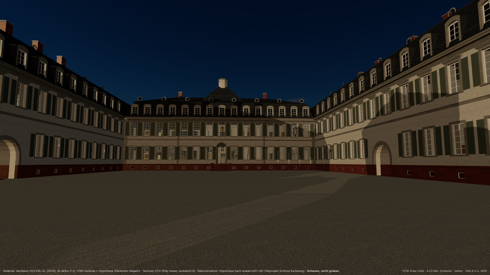

# 🏰 Schloss Karlsberg 1789 — 3D reconstruction

Sub-project of the Saar LiDAR Explorer. It is a researched, georeferenced reconstruction of Schloss Karlsberg near Homburg (Duke Karl II. August, built 1778–1788, burnt 1793) and the whole residence as of **15 July 1789**, with a generator, a standalone viewer (Fliegen / Gehen) and 30 plan sheets. Everything it shows is a **hypothesis** with evidence tags and confidence levels. **Schauen, nicht graben.**



## 🧭 Status

| | |
|---|---|
| ✅ Done | Research 01–11, catalogue v2, generator (exteriors, 7 interiors, 1789 site and gardens), viewer, plan sheets, explorer light layer + camera handover, improvement waves 0–11 |
| ⏸️ Paused | Improvement rounds. Open items: [docs/improvement-backlog.md](docs/improvement-backlog.md) |
| 🚧 Next (explorer v2) | Becomes **zone #1** behind a portal ([ADR 0015](../../docs/adr/0015-overworld-zones-portals.md), [0016](../../docs/adr/0016-zone-kinds-zone-contract.md)); UI trimmed to the tiers of [ADR 0019](../../docs/adr/0019-feature-tiers.md) / [0020](../../docs/adr/0020-remove-move-out-freeze.md) (1789 only, no 2025 switch, no Vollmondnacht, festivals frozen) |

History: [CHANGELOG.md](CHANGELOG.md) · frozen long-form README and backlog: [docs/history/](docs/history/).

## 🚀 Run

```bash
pnpm install && pnpm run dev     # viewer → http://localhost:5260/
pnpm run test && pnpm run build  # the gates
```

All commands (plans, glTF export, explorer light layer, textures, terrain prep, diagnostics): [CLAUDE.md](CLAUDE.md#commands).

## 🎮 Viewer

| Key | Action |
|---|---|
| Click canvas | Mouse look (pointer lock) |
| `W` `A` `S` `D` / arrows · `Shift` | Move · fast |
| `Q` / `E` (PageDown / PageUp) | Down / up in Fliegen |
| `Space` | Jump in Gehen |
| `F` · `G` | Fliegen · Gehen |
| `M` | Zurück zur Karte (explorer at the same pose) |
| `P` | Foto (2× / 3× still with attribution and „Rekonstruktion – Hypothese“) |

Panel: **▶ Rundflug** (≈ 70 s, Kino look), *Gehe zu* places and rooms, time of day, *Kino* / *Dokumentation* look, quality, confidence colours.

**Test hooks:** `window.skb` with `goto`, `pose`, `step`, `set`, `look`, `quality`, `gpuBench`, `handover`, `backUrl`, `tour*`, `photo` and more (`Object.keys(window.skb)` lists them all). Automated tabs are often hidden, so drive frames with `skb.step(n)`. Explorer handover: `?src=explorer&E=…&N=…&h=…&heading=…&pitch=…&mode=fliegen|gehen&back=…` ([docs/explorer-integration.md](docs/explorer-integration.md)).

## ⚖️ Principles

- **Evidence first.** Every building and part carries a confidence level and its sources. Inferences are tagged, and unlocated features are not built (no invented geometry). No HMS video frames or textures ([ADR 0011](../../docs/adr/0011-castle-evidence-no-hms.md)).
- **Georeferenced.** EPSG:25832, DHHN2016, local frame `x = E − 381000`, `y = h`, `z = −(N − 5465000)`, true heights. It drops into the explorer without transforms.
- **Heritage law.** Protected monument (SDschG Saarland / DSchG RLP). For looking, not for digging.
- **Media out of git.** Videos, frames, textures, terrain and shots are git-ignored. An image is committed only if a doc links it.

## 🗂️ Layout

| Path | What |
|---|---|
| `research/` | 01–11: history and sources, comparable palaces, LiDAR site analysis, video, period sources, building practice, gardens |
| `scripts/catalogue-v2/` | Deterministic catalogue builder → `model/catalogue.json` |
| `model/` | Generator: `src/layout` (the single layout truth), `src/exterior`, `src/interior`, `src/site`, `src/materials`; tests |
| `viewer/` | Standalone three.js viewer |
| `plans/` | Lagepläne, Grundrisse, Ansichten, Schnitte (SVG / PDF; previews regenerate into the ignored `docs/plans-preview/`) |
| `docs/` | [architecture.md](docs/architecture.md) (**binding** contract), [explorer-integration.md](docs/explorer-integration.md), [visual-audit.md](docs/visual-audit.md), [improvement-backlog.md](docs/improvement-backlog.md) |
| `video2world/` | Video → 3D (Apple Object Capture); the base for captured zones ([ADR 0027](../../docs/adr/0027-captured-zone-method.md)) |
